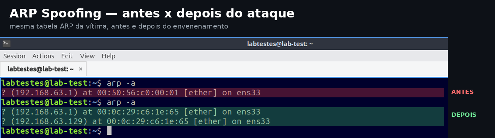
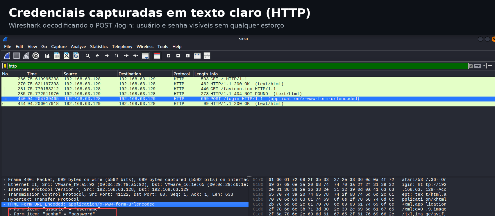

# Laboratório de ARP Spoofing — Captura de credenciais em texto claro

Laboratório prático demonstrando um ataque de **ARP Spoofing** seguido de captura de credenciais trafegadas em **HTTP sem criptografia**, executado em um ambiente isolado e de minha propriedade.



> ⚠️ **Aviso ético**: este experimento foi realizado inteiramente em uma rede virtual isolada (VMware, modo Host-only), sem conexão com a internet e sem qualquer terceiro conectado ou afetado. Nenhuma técnica aqui descrita deve ser aplicada em redes, dispositivos ou sistemas sem autorização explícita do proprietário. ARP Spoofing contra redes de terceiros é crime (no Brasil, Lei 12.737/2012 — Lei Carolina Dieckmann; e em geral enquadrável como invasão de dispositivo informático).

## Índice

- [Objetivo](#objetivo)
- [Como funciona o ARP Spoofing](#como-funciona-o-arp-spoofing)
- [Ambiente](#ambiente)
- [Ferramentas utilizadas](#ferramentas-utilizadas)
- [Metodologia](#metodologia)
- [Evidências](#evidências)
- [Como reproduzir](#como-reproduzir)
- [Limitações e próximos passos](#limitações-e-próximos-passos)
- [Mitigações](#mitigações)
- [Referências](#referências)

## Objetivo

Demonstrar, de ponta a ponta, como a ausência de proteções contra ARP Spoofing na camada 2 combinada com tráfego HTTP não criptografado permite a um atacante capturar credenciais de um usuário na mesma rede local — e documentar o processo com rigor técnico suficiente para compor um portfólio de segurança ofensiva.

## Como funciona o ARP Spoofing

O protocolo **ARP** (Address Resolution Protocol) resolve endereços IP para endereços MAC dentro de uma rede local. Ele não possui nenhum mecanismo de autenticação: qualquer dispositivo pode anunciar "eu sou o dono deste IP" e os demais aceitam a informação sem verificação.

Um atacante explora isso enviando **ARP replies forjados**, convencendo a vítima de que o MAC do atacante corresponde a um IP legítimo da rede (tipicamente o gateway). A vítima passa a enviar tráfego para o atacante sem perceber — a base técnica de um ataque **Man-in-the-Middle (MITM)** de camada 2.

```
Antes do ataque:                    Depois do ARP Spoofing:

Vítima                              Vítima
  │ ARP: quem é 192.168.63.1?         │ ARP: quem é 192.168.63.1?
  ▼                                   ▼
Gateway responde com                Atacante responde primeiro,
seu MAC real                        forjando o MAC do gateway
  │                                   │
  ▼                                   ▼
Tráfego vai direto                  Tráfego passa pelo
para o gateway                      atacante antes de seguir
```

## Ambiente

| Item | Detalhe |
| --- | --- |
| Atacante | Kali Linux — `192.168.63.129` |
| Vítima | Lubuntu 26.04 LTS — `192.168.63.128` (hostname `lab-test`) |
| Rede | VMware Host-only, `192.168.63.0/24`, isolada, sem gateway real |
| Host físico | Ambas as VMs rodando na mesma máquina, de minha propriedade |
| Alvo 2 do ARP spoof | `192.168.63.1` (adaptador de serviço da própria VMware no host, usado como "gateway" simbólico) |
| Serviço-alvo | Página de login de teste (Flask), hospedada no próprio Kali, porta 80 |

## Ferramentas utilizadas

| Ferramenta | Função |
| --- | --- |
| Kali Linux | Sistema operacional do atacante |
| `arp-scan` / `ping` | Reconhecimento de rede |
| `ettercap` (modo texto) | Execução do ARP Spoofing |
| Wireshark | Captura e análise de pacotes |
| Python / Flask | Servidor de teste simulando um portal de login |
| Lubuntu + Chromium | Sistema e navegador da vítima |

## Metodologia

1. **Reconhecimento** — `arp-scan --localnet` e `ping` confirmam a conectividade entre as duas VMs.
2. **Preparação do alvo** — um servidor Flask é criado no Kali, servindo uma página de login de teste e registrando qualquer credencial recebida.
3. **Baseline** — `arp -a` na vítima, antes do ataque, registra o MAC legítimo associado a `192.168.63.1`.
4. **ARP Spoofing** — no Kali:
   ```bash
   sudo ettercap -T -M arp:remote /192.168.63.128// /192.168.63.1//
   ```
5. **Confirmação do envenenamento** — novo `arp -a` na vítima mostra `192.168.63.1` respondendo com o MAC do Kali.
6. **Captura das credenciais** — a vítima acessa o portal de teste e envia um login; as credenciais são capturadas tanto no log do servidor Flask quanto no Wireshark, em texto claro.
7. **Encerramento** — o ataque é interrompido (`q` no ettercap) e a tabela ARP da vítima é restaurada automaticamente.

## Evidências

### Credenciais capturadas no Wireshark

Wireshark decodifica diretamente os campos do formulário a partir do pacote `POST /login` — usuário e senha visíveis sem qualquer esforço adicional.



### Passo a passo completo

| # | Evidência | Descrição |
| --- | --- | --- |
| 1 | `01-portal-login-vazio.png` | Vítima acessa o portal de login de teste |
| 2 | `02-login-preenchido.png` | Vítima preenche usuário e senha |
| 3 | `03-arp-antes.png` | Tabela ARP da vítima **antes** do ataque (MAC legítimo) |
| 4 | `05-arp-depois.png` | Tabela ARP da vítima **depois** do ataque (MAC do atacante) |
| 5 | `06-flask-setup.png` | Servidor de teste (Flask) sendo configurado no atacante |
| 6 | `07-credenciais-capturadas-servidor.png` | Log do servidor com as credenciais recebidas em texto claro |
| 7 | `08-wireshark-pacote-post.png` | Pacote `POST /login` capturado e decodificado no Wireshark |
| 8 | `09-wireshark-http-stream.jpg` | Stream HTTP completo (`Follow → HTTP Stream`), requisição e resposta |
| 9 | `10-login-confirmado.png` | Confirmação do login recebido, do lado da vítima |
| 10 | `11-ettercap-encerrado.png` | Encerramento do ataque e restauração automática do ARP |

## Como reproduzir

Em um ambiente **isolado e de sua propriedade** (nunca em rede de terceiros):

1. Crie duas VMs na mesma rede Host-only (ou rede isolada equivalente): uma com Kali Linux (atacante), outra com qualquer distro leve (vítima).
2. No atacante, suba um servidor HTTP de teste:
   ```bash
   pip install flask --break-system-packages
   python3 app.py   # serve uma página de login simples na porta 80
   ```
3. Confirme conectividade: `arp-scan --localnet`, `ping`.
4. Registre o `arp -a` da vítima antes do ataque.
5. Execute o ARP Spoofing: `sudo ettercap -T -M arp:remote /IP_VITIMA// /IP_ALVO2//`
6. Gere tráfego na vítima (acesse a página de teste) e capture com Wireshark no atacante.
7. Encerre o ataque e confirme a restauração do ARP.

## Limitações e próximos passos

Neste experimento, a vítima acessa a página de login **diretamente no IP do atacante** — ou seja, o tráfego capturado já tinha o atacante como destino real, e não foi "desviado" de um terceiro por meio do ARP Spoofing.

Isso significa que o laboratório comprova, de forma independente:

- Que o ARP Spoofing funciona e altera a tabela ARP da vítima (evidências 3 → 4).
- Que tráfego HTTP sem criptografia expõe credenciais em texto claro a qualquer um que o capture (evidências 6, 7 e 8).

Mas **não demonstra** a interceptação de tráfego destinado a um terceiro legítimo (o cenário clássico de MITM "vítima → gateway → internet"), já que não havia uma terceira máquina real na rede isolada.

**Próximo passo natural**: adicionar uma terceira máquina atuando como "servidor legítimo" para demonstrar a interceptação de tráfego de terceiros de verdade, e encadear DNS Spoofing + SSL Stripping para mostrar como HTTPS/HSTS mitiga esse tipo de ataque na prática.

## Mitigações

| Mitigação | Como funciona |
| --- | --- |
| Dynamic ARP Inspection (DAI) | Switches gerenciados validam pares IP-MAC contra uma tabela confiável (DHCP snooping) e descartam ARP replies suspeitos |
| Entradas ARP estáticas | Fixar manualmente IP-MAC de hosts críticos impede sobrescrita por spoofing — não escala bem |
| Segmentação de rede / VLANs | Reduz o domínio de broadcast onde o ARP spoofing é eficaz |
| 802.1X | Autenticação por porta impede dispositivos não autorizados na rede local |
| HTTPS/TLS + HSTS | Não impede o ARP spoofing, mas impede que o atacante leia o conteúdo interceptado — a mitigação mais relevante para o cenário de roubo de credenciais mostrado aqui |
| Ferramentas de detecção (arpwatch, XArp) | Monitoram mudanças suspeitas na tabela ARP da rede e alertam administradores |

## Referências

- [RFC 826 — An Ethernet Address Resolution Protocol](https://datatracker.ietf.org/doc/html/rfc826)
- [Ettercap — documentação oficial](https://www.ettercap-project.org/)
- [OWASP — Man-in-the-Middle Attack](https://owasp.org/www-community/attacks/Man-in-the-middle_attack)

## Autor

Laboratório pessoal de estudo em cibersegurança, com foco em segurança ofensiva (pentest).
